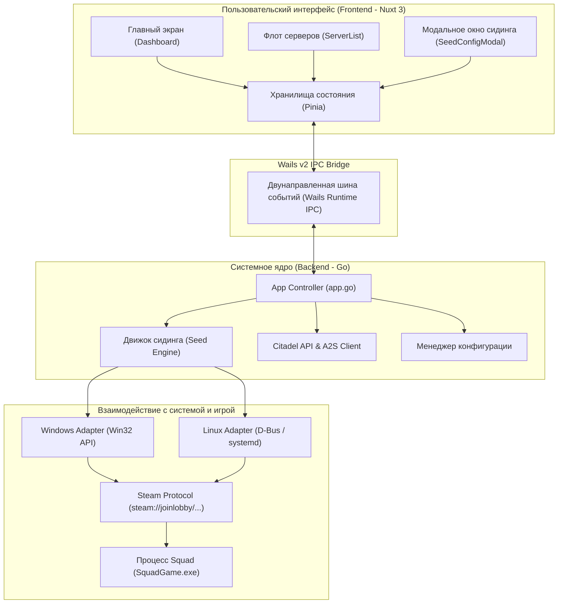
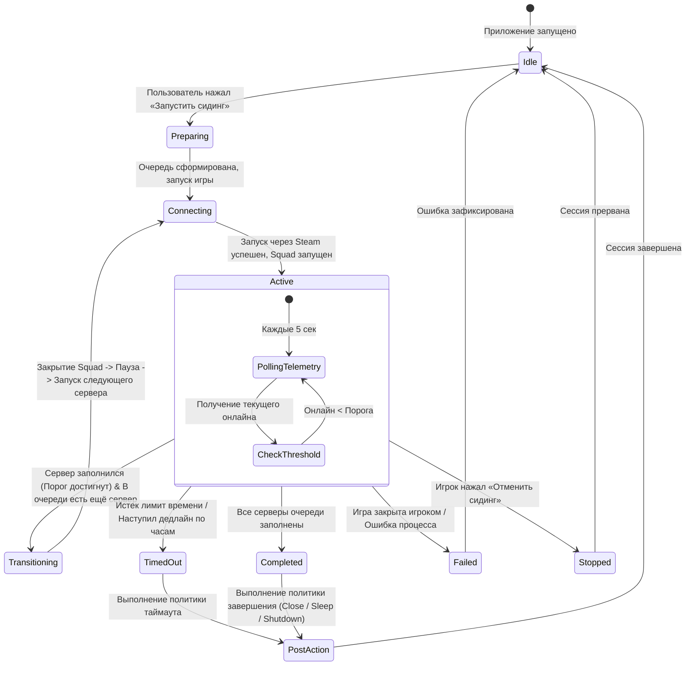
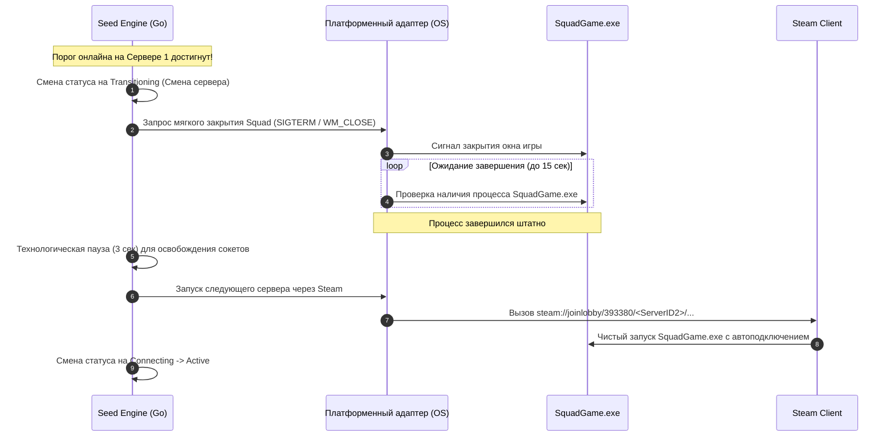
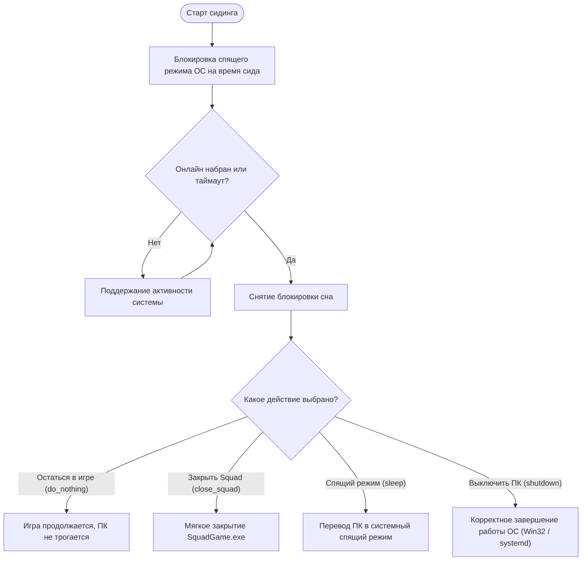

# Архитектура и принципы работы Citadel Sentry 🏗️

В данном документе подробно описано внутреннее устройство, схема компонентов, машина состояний сидинга и протоколы взаимодействия приложения **Citadel Sentry**.

---

## 1. Общая схема компонентов

Citadel Sentry построен по гибридной архитектуре: высокопроизводительный системный бэкенд на **Go** в связке с легковесным пользовательским интерфейсом на **Vue 3 / Nuxt 3 / Tailwind CSS**, объединёнными через легковесный нативный контейнер **Wails v2**.

---

## 2. Машина состояний движка сидинга (Seed Engine State Machine)

Сердцем приложения является детерминированный конечный автомат (State Machine), реализованный в пакете `internal/seed/engine.go`.

---

## 3. Схема безопасного переключения серверов (Queue Transition)

При сидировании очереди из нескольких серверов (например, 2 или 3 сервера подряд) Squad не умеет мгновенно и без сбоев переключаться между серверами из внешних ссылок без закрытия текущей сессии. 

Поэтому Citadel Sentry выполняет строго выверенную и безопасную последовательность:

---

## 4. Безопасное управление питанием (Power Management)

Citadel Sentry защищает компьютер от случайных выключений или зависаний во время сидинга.

### Реализация блокировки сна:
- **Windows**: Использование системного вызова `SetThreadExecutionState(ES_CONTINUOUS | ES_SYSTEM_REQUIRED | ES_AWAYMODE_REQUIRED)`. Это предотвращает засыпание экрана и переход системы в ждущий режим во время работы миссии.
- **Linux**: Использование системной шины `systemd-inhibit` (D-Bus) с блокировкой типа `sleep` и понятным описанием причины (`Citadel Sentry seed session`).

### Реализация выключения / сна:
- **Windows**: Вызов `ExitWindowsEx` с флагами `EWX_SHUTDOWN | EWX_POWEROFF` или `SetSuspendState` для сна. Все фоновые приложения получают стандартное системное уведомление о сохранении данных.
- **Linux**: Вызов штатных команд `systemctl poweroff` / `systemctl suspend` (или через D-Bus `org.freedesktop.login1.Manager`). Никаких опасных прямых сбросов питания (`kill -9 1` или аппаратных зависаний).
